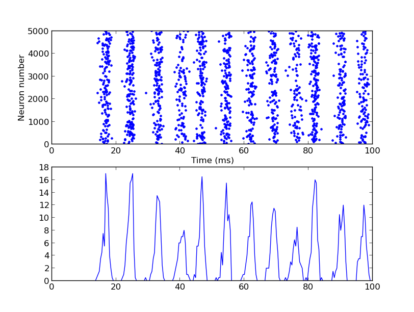

# For the paper:

**Fast Global Oscillations in Networks of Integrate-and-Fire Neurons with Low Firing Rates**  
Nicolas Brunel & Vincent Hakim  
*Neural Computation* 11, 1621-1671 (1999)

A Brian simulator model is available at this web page:

[http://briansimulator.org/docs/examples-frompapers_Brunel_Hakim_1999.html](http://briansimulator.org/docs/examples-frompapers_Brunel_Hakim_1999.html)

That reproduces an example of Figure 3C

This simulation requires Brian which can be downloaded and installed from the instructions available at [http://www.briansimulator.org/](http://www.briansimulator.org/)

For support on installing and using Brian simulations there is a support group at [https://groups.google.com/group/briansupport](https://groups.google.com/group/briansupport).

---

2025-07-09: Converted README to Markdown.